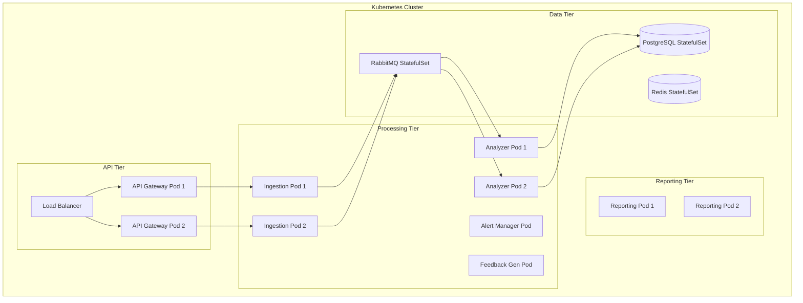

# Technical Design Document
 
## Overview

The Student Concept Drift Detection System is a real-time analytics platform that monitors student learning behavior to identify conceptual decline before it impacts academic performance. The system processes interaction data from learning activities (quizzes, coding exercises, assignments), establishes personalized baseline patterns, detects behavioral deviations using statistical analysis, and generates actionable alerts and feedback.

### Key Design Goals

1. **Real-time Processing**: Analyze interactions and generate alerts within minutes of activity completion
2. **Statistical Rigor**: Use proven statistical methods (z-scores, rolling windows) for drift detection
3. **Scalability**: Support thousands of concurrent students with sub-second query performance
4. **Privacy-First**: Implement encryption, access control, and audit logging throughout
5. **Configurability**: Allow administrators to tune sensitivity parameters for different educational contexts
6. **Extensibility**: Design modular components that can integrate with various LMS platforms

### System Boundaries

**In Scope:**
- Capturing and storing student interaction data
- Statistical analysis and drift detection algorithms
- Alert generation and delivery mechanisms
- Feedback generation with resource recommendations
- Visual reporting and dashboards
- Configuration management
- Data privacy and security controls

**Out of Scope:**
- Learning Management System (LMS) implementation
- Content creation tools for learning activities
- Student authentication and authorization (delegated to LMS)
- Email/SMS delivery infrastructure (uses external services)
- Machine learning model training (uses statistical methods only)

## Architecture

### High-Level Architecture

The system follows a microservices architecture with event-driven communication:

```mermaid
graph TB
    LMS[Learning Management System] -->|Activity Events| API[API Gateway]
    API --> Ingestion[Data Ingestion Service]
    Ingestion -->|Store| DB[(PostgreSQL Database)]
    Ingestion -->|Publish| Queue[Message Queue - RabbitMQ]
    
    Queue -->|Consume| Analyzer[Drift Analysis Service]
    Analyzer -->|Read/Write| DB
    Analyzer -->|Publish| Queue
    
    Queue -->|Consume| AlertMgr[Alert Manager Service]
    Queue -->|Consume| FeedbackGen[Feedback Generator Service]
    
    AlertMgr -->|Notify| NotifSvc[Notification Service]
    FeedbackGen -->|Notify| NotifSvc
    NotifSvc -->|Email/Push| Instructors[Instructors]
    NotifSvc -->|In-App| Students[Students]
    
    API --> ReportSvc[Reporting Service]
    ReportSvc -->|Query| DB
    ReportSvc -->|Render| Viz[Visualization Engine]
    Viz --> Dashboard[Web Dashboard]
    
    Admin[Administrators] -->|Configure| API
    API --> ConfigSvc[Configuration Service]
    ConfigSvc -->|Store| DB
    
    subgraph Security Layer
        Auth[Authentication/Authorization]
        Encrypt[Encryption Service]
        Audit[Audit Logger]
    end
    
    API --> Auth
    DB --> Encrypt
    All[All Services] -.->|Log Access| Audit
```



### Technology Stack

**Backend Services:**
- **Language**: Python 3.11+ (for statistical libraries and rapid development)
- **Framework**: FastAPI (async support, automatic OpenAPI documentation)
- **Message Queue**: RabbitMQ (reliable message delivery, dead-letter queues)
- **Database**: PostgreSQL 15+ (JSONB support, time-series extensions)
- **Cache**: Redis (session management, rate limiting)

**Data Processing:**
- **Statistical Analysis**: NumPy, SciPy (z-score calculations, statistical tests)
- **Time Series**: Pandas (rolling windows, aggregations)
- **Data Validation**: Pydantic (schema validation, type safety)

**Security:**
- **Encryption**: cryptography library (AES-256-GCM)
- **Authentication**: OAuth 2.0 / OpenID Connect (delegated to LMS)
- **Authorization**: Casbin (policy-based access control)

**Visualization:**
- **Frontend**: Vanilla JavaScript (matching existing codebase style)
- **Charting**: Chart.js (already integrated in current system)
- **UI Framework**: Custom CSS with modern gradient design (navy blue theme: #1e3a8a, #3730a3)
- **Design Style**: Modern dashboard with animated backgrounds, card-based layouts, toast notifications

**Infrastructure:**
- **Containerization**: Docker
- **Orchestration**: Kubernetes
- **Monitoring**: Prometheus + Grafana
- **Logging**: ELK Stack (Elasticsearch, Logstash, Kibana)

### Deployment Architecture



## Components and Interfaces

### 1. Data Ingestion Service

**Responsibility**: Receive, validate, and store student interaction data from LMS platforms.

**Key Operations:**
- `POST /api/v1/interactions` - Submit new interaction data
- `GET /api/v1/interactions/{student_id}` - Retrieve interaction history

**Input Schema:**
```json
{
  "student_id": "string (UUID)",
  "activity_id": "string (UUID)",
  "activity_type": "enum (quiz, coding_exercise, assignment)",
  "accuracy": "float (0.0-100.0)",
  "time_taken_seconds": "integer (>0)",
  "retry_count": "integer (>=0)",
  "problem_solving_steps": "integer (>=0)",
  "timestamp": "string (ISO 8601 UTC)"
}
```

**Processing Logic:**
1. Validate input against schema (Pydantic models)
2. Encrypt sensitive fields (student_id, activity details)
3. Store in PostgreSQL `interactions` table
4. Publish `interaction.created` event to RabbitMQ
5. Return 201 Created with interaction ID

**Error Handling:**
- 400 Bad Request: Invalid schema or out-of-range values
- 401 Unauthorized: Missing or invalid authentication token
- 429 Too Many Requests: Rate limit exceeded (100 req/min per student)
- 500 Internal Server Error: Database or queue unavailable

### 2. Drift Analysis Service

**Responsibility**: Calculate baseline patterns, detect behavioral changes, and compute drift scores.

**Key Operations:**
- Event-driven processing (consumes `interaction.created` events)
- Background job: Recalculate baselines every 6 hours

**Algorithm Specifications:**

**Baseline Calculation:**
```python
def calculate_baseline(student_id: str, window_size: int = 20) -> BaselinePattern:
    """
    Calculate baseline pattern from recent interactions.
    Requires minimum 5 interactions.
    """
    interactions = get_recent_interactions(student_id, limit=window_size)
    
    if len(interactions) < 5:
        return None  # Insufficient data
    
    metrics = ['accuracy', 'time_taken_seconds', 'retry_count', 'problem_solving_steps']
    baseline = {}
    
    for metric in metrics:
        values = [getattr(i, metric) for i in interactions]
        baseline[f'{metric}_mean'] = np.mean(values)
        baseline[f'{metric}_std'] = np.std(values, ddof=1)  # Sample std dev
    
    baseline['last_updated'] = datetime.utcnow()
    baseline['sample_size'] = len(interactions)
    
    return BaselinePattern(**baseline)
```

**Behavioral Change Detection:**
```python
def detect_behavioral_changes(
    interaction: Interaction,
    baseline: BaselinePattern,
    std_multiplier: float = 2.0
) -> List[BehavioralChange]:
    """
    Detect deviations using z-score method.
    Flag changes beyond std_multiplier standard deviations.
    """
    changes = []
    
    # Accuracy: flag if drops below baseline
    z_accuracy = (interaction.accuracy - baseline.accuracy_mean) / baseline.accuracy_std
    if z_accuracy < -std_multiplier:
        changes.append(BehavioralChange(
            metric='accuracy',
            z_score=z_accuracy,
            direction='decrease',
            severity=abs(z_accuracy)
        ))
    
    # Time taken: flag if increases above baseline
    z_time = (interaction.time_taken_seconds - baseline.time_taken_seconds_mean) / baseline.time_taken_seconds_std
    if z_time > std_multiplier:
        changes.append(BehavioralChange(
            metric='time_taken',
            z_score=z_time,
            direction='increase',
            severity=z_time
        ))
    
    # Retry count: flag if increases above baseline
    z_retry = (interaction.retry_count - baseline.retry_count_mean) / baseline.retry_count_std
    if z_retry > std_multiplier:
        changes.append(BehavioralChange(
            metric='retry_count',
            z_score=z_retry,
            direction='increase',
            severity=z_retry
        ))
    
    # Problem-solving steps: flag if decreases below baseline
    z_steps = (interaction.problem_solving_steps - baseline.problem_solving_steps_mean) / baseline.problem_solving_steps_std
    if z_steps < -std_multiplier:
        changes.append(BehavioralChange(
            metric='problem_solving_steps',
            z_score=z_steps,
            direction='decrease',
            severity=abs(z_steps)
        ))
    
    return changes
```

**Drift Score Calculation:**
```python
def calculate_drift_score(
    student_id: str,
    sliding_window_size: int = 10,
    weights: Dict[str, float] = {
        'accuracy': 0.40,
        'time_taken': 0.25,
        'retry_count': 0.20,
        'problem_solving_steps': 0.15
    }
) -> float:
    """
    Calculate drift score (0.0-1.0) based on recent behavioral changes.
    Higher scores indicate greater risk of conceptual decline.
    """
    recent_interactions = get_recent_interactions(student_id, limit=sliding_window_size)
    baseline = get_baseline(student_id)
    
    if not baseline or len(recent_interactions) < 5:
        return 0.0  # Insufficient data
    
    # Count behavioral changes per metric in sliding window
    metric_change_counts = {
        'accuracy': 0,
        'time_taken': 0,
        'retry_count': 0,
        'problem_solving_steps': 0
    }
    
    for interaction in recent_interactions:
        changes = detect_behavioral_changes(interaction, baseline)
        for change in changes:
            metric_change_counts[change.metric] += 1
    
    # Calculate weighted score
    drift_score = 0.0
    for metric, weight in weights.items():
        # Normalize by window size (max 1.0 if all interactions flagged)
        metric_score = metric_change_counts[metric] / sliding_window_size
        drift_score += metric_score * weight
    
    # Clamp to [0.0, 1.0]
    return min(max(drift_score, 0.0), 1.0)
```

**Event Publishing:**
After calculating drift score, publish events:
- `drift.score_calculated` - Always published with score
- `drift.threshold_exceeded` - Published when score > threshold

### 3. Alert Manager Service

**Responsibility**: Generate and deliver instructor alerts when drift thresholds are exceeded.

**Key Operations:**
- Consumes `drift.threshold_exceeded` events
- `GET /api/v1/alerts` - Retrieve alerts for instructor
- `PATCH /api/v1/alerts/{alert_id}` - Mark alert as acknowledged

**Alert Generation Logic:**
```python
def create_alert(drift_event: DriftThresholdExceededEvent) -> Alert:
    """
    Create instructor alert with contextual information.
    """
    student = get_student(drift_event.student_id)
    baseline = get_baseline(drift_event.student_id)
    recent_changes = get_recent_behavioral_changes(
        drift_event.student_id,
        limit=10
    )
    
    # Identify primary concern metrics
    concern_metrics = [
        change.metric for change in recent_changes
        if change.severity > 2.5  # High severity threshold
    ]
    
    alert = Alert(
        alert_id=generate_uuid(),
        student_id=drift_event.student_id,
        student_name=student.name,
        drift_score=drift_event.drift_score,
        concern_metrics=concern_metrics,
        detection_period_start=drift_event.window_start,
        detection_period_end=drift_event.window_end,
        priority=calculate_priority(drift_event.drift_score),
        created_at=datetime.utcnow(),
        status='pending'
    )
    
    return alert

def calculate_priority(drift_score: float) -> str:
    """Assign priority based on drift score."""
    if drift_score >= 0.85:
        return 'critical'
    elif drift_score >= 0.75:
        return 'high'
    else:
        return 'medium'
```

**Delivery Mechanism:**
1. Store alert in database
2. Query authorized instructors for student
3. Send notifications via Notification Service (email, push, in-app)
4. Guarantee delivery within 5 minutes using retry logic

**Authorization Check:**
```python
def get_authorized_instructors(student_id: str) -> List[str]:
    """
    Query LMS for instructors authorized to view student data.
    Uses Casbin policy enforcement.
    """
    enrollments = get_student_enrollments(student_id)
    instructor_ids = []
    
    for enrollment in enrollments:
        course_instructors = get_course_instructors(enrollment.course_id)
        for instructor in course_instructors:
            # Check Casbin policy: instructor can view student in course
            if enforcer.enforce(instructor.id, student_id, 'view_alerts'):
                instructor_ids.append(instructor.id)
    
    return list(set(instructor_ids))  # Deduplicate
```

### 4. Feedback Generator Service

**Responsibility**: Create personalized student feedback with resource recommendations.

**Key Operations:**
- Consumes `drift.score_calculated` events (threshold: 0.5)
- `GET /api/v1/feedback/{student_id}` - Retrieve feedback history

**Feedback Generation Logic:**
```python
def generate_feedback(drift_event: DriftScoreCalculatedEvent) -> Feedback:
    """
    Generate encouraging, actionable feedback for students.
    """
    if drift_event.drift_score < 0.5:
        return None  # Below feedback threshold
    
    recent_changes = get_recent_behavioral_changes(
        drift_event.student_id,
        limit=10
    )
    
    # Identify skill areas with decline
    skill_gaps = identify_skill_gaps(recent_changes)
    
    # Map to learning resources
    resources = recommend_resources(skill_gaps)
    
    # Generate encouraging message
    message = compose_feedback_message(
        drift_score=drift_event.drift_score,
        skill_gaps=skill_gaps,
        tone='encouraging'
    )
    
    feedback = Feedback(
        feedback_id=generate_uuid(),
        student_id=drift_event.student_id,
        drift_score=drift_event.drift_score,
        message=message,
        skill_gaps=skill_gaps,
        recommended_resources=resources,
        practice_activities=suggest_practice_activities(skill_gaps),
        created_at=datetime.utcnow()
    )
    
    return feedback
```

**Message Composition:**
```python
def compose_feedback_message(
    drift_score: float,
    skill_gaps: List[str],
    tone: str = 'encouraging'
) -> str:
    """
    Compose feedback using positive framing.
    Avoid negative language like "failing" or "struggling".
    """
    templates = {
        'opening': [
            "We've noticed some changes in your recent learning activities.",
            "Your learning patterns have shifted recently.",
            "We're here to help you stay on track."
        ],
        'skill_identification': [
            "It looks like {skill_area} could use some extra attention.",
            "Focusing on {skill_area} will help strengthen your understanding.",
            "Let's work together on {skill_area}."
        ],
        'encouragement': [
            "You've got this! Small adjustments can make a big difference.",
            "Every learner faces challenges - you're taking the right steps.",
            "Your progress matters, and we're here to support you."
        ]
    }
    
    # Select templates based on drift severity
    opening = random.choice(templates['opening'])
    skill_messages = [
        templates['skill_identification'][0].format(skill_area=gap)
        for gap in skill_gaps[:3]  # Limit to top 3
    ]
    encouragement = random.choice(templates['encouragement'])
    
    message = f"{opening}\n\n{' '.join(skill_messages)}\n\n{encouragement}"
    return message
```

### 5. Reporting Service

**Responsibility**: Generate visual reports and dashboards for instructors and students.

**Key Operations:**
- `GET /api/v1/reports/student/{student_id}/drift-timeline` - Time-series drift data
- `GET /api/v1/reports/student/{student_id}/metric-breakdown` - Metric contribution chart
- `GET /api/v1/reports/student/{student_id}/baseline-comparison` - Current vs baseline
- `GET /api/v1/reports/class/{class_id}/dashboard` - Aggregate class view

**Report Data Structures:**

**Drift Timeline:**
```json
{
  "student_id": "uuid",
  "period_days": 30,
  "data_points": [
    {
      "date": "2024-01-15",
      "drift_score": 0.45,
      "behavioral_changes": 3
    }
  ],
  "color_zones": {
    "green": {"max": 0.3},
    "yellow": {"min": 0.3, "max": 0.7},
    "red": {"min": 0.7}
  }
}
```

**Metric Breakdown:**
```json
{
  "student_id": "uuid",
  "current_drift_score": 0.72,
  "contributions": [
    {
      "metric": "accuracy",
      "weight": 0.40,
      "change_frequency": 0.8,
      "contribution": 0.32
    },
    {
      "metric": "time_taken",
      "weight": 0.25,
      "change_frequency": 0.6,
      "contribution": 0.15
    }
  ]
}
```

**Performance Requirements:**
- Query optimization: Use PostgreSQL indexes on (student_id, timestamp)
- Caching: Redis cache for frequently accessed reports (TTL: 5 minutes)
- Rendering: Complete within 3 seconds for individual reports
- Pagination: Class dashboards limited to 50 students per page

### 6. Configuration Service

**Responsibility**: Manage system-wide and course-specific drift detection parameters.

**Key Operations:**
- `GET /api/v1/config` - Retrieve current configuration
- `PUT /api/v1/config` - Update configuration (admin only)
- `GET /api/v1/config/courses/{course_id}` - Course-specific overrides

**Configuration Schema:**
```json
{
  "drift_threshold": 0.7,
  "std_multiplier": 2.0,
  "sliding_window_size": 10,
  "baseline_window_size": 20,
  "metric_weights": {
    "accuracy": 0.40,
    "time_taken": 0.25,
    "retry_count": 0.20,
    "problem_solving_steps": 0.15
  },
  "feedback_threshold": 0.5,
  "alert_delivery_timeout_minutes": 5,
  "feedback_delivery_timeout_minutes": 10,
  "inactive_threshold_days": 14,
  "data_retention_days": 730
}
```

**Validation Rules:**
- `drift_threshold`: 0.1 ≤ value ≤ 0.9
- `std_multiplier`: 1.5 ≤ value ≤ 3.0
- `sliding_window_size`: 5 ≤ value ≤ 30
- `metric_weights`: Sum must equal 1.0 (100%)
- All weights: 0.0 ≤ value ≤ 1.0

**Configuration Propagation:**
1. Validate new configuration
2. Store in database with version number
3. Publish `config.updated` event to RabbitMQ
4. All services consume event and reload configuration
5. Guarantee propagation within 1 minute

## Data Models

### Database Schema (PostgreSQL)

**interactions table:**
```sql
CREATE TABLE interactions (
    interaction_id UUID PRIMARY KEY DEFAULT gen_random_uuid(),
    student_id_encrypted BYTEA NOT NULL,
    activity_id_encrypted BYTEA NOT NULL,
    activity_type VARCHAR(50) NOT NULL,
    accuracy DECIMAL(5,2) NOT NULL CHECK (accuracy >= 0 AND accuracy <= 100),
    time_taken_seconds INTEGER NOT NULL CHECK (time_taken_seconds > 0),
    retry_count INTEGER NOT NULL CHECK (retry_count >= 0),
    problem_solving_steps INTEGER NOT NULL CHECK (problem_solving_steps >= 0),
    timestamp TIMESTAMPTZ NOT NULL,
    created_at TIMESTAMPTZ DEFAULT NOW(),
    INDEX idx_student_timestamp (student_id_encrypted, timestamp DESC),
    INDEX idx_activity (activity_id_encrypted)
);
```

**baselines table:**
```sql
CREATE TABLE baselines (
    baseline_id UUID PRIMARY KEY DEFAULT gen_random_uuid(),
    student_id_encrypted BYTEA NOT NULL UNIQUE,
    accuracy_mean DECIMAL(5,2) NOT NULL,
    accuracy_std DECIMAL(5,2) NOT NULL,
    time_taken_seconds_mean DECIMAL(10,2) NOT NULL,
    time_taken_seconds_std DECIMAL(10,2) NOT NULL,
    retry_count_mean DECIMAL(5,2) NOT NULL,
    retry_count_std DECIMAL(5,2) NOT NULL,
    problem_solving_steps_mean DECIMAL(5,2) NOT NULL,
    problem_solving_steps_std DECIMAL(5,2) NOT NULL,
    sample_size INTEGER NOT NULL,
    last_updated TIMESTAMPTZ NOT NULL,
    created_at TIMESTAMPTZ DEFAULT NOW(),
    INDEX idx_student (student_id_encrypted)
);
```

**behavioral_changes table:**
```sql
CREATE TABLE behavioral_changes (
    change_id UUID PRIMARY KEY DEFAULT gen_random_uuid(),
    interaction_id UUID NOT NULL REFERENCES interactions(interaction_id),
    student_id_encrypted BYTEA NOT NULL,
    metric VARCHAR(50) NOT NULL,
    z_score DECIMAL(10,4) NOT NULL,
    direction VARCHAR(20) NOT NULL,
    severity DECIMAL(10,4) NOT NULL,
    detected_at TIMESTAMPTZ DEFAULT NOW(),
    INDEX idx_student_detected (student_id_encrypted, detected_at DESC)
);
```

**drift_scores table:**
```sql
CREATE TABLE drift_scores (
    score_id UUID PRIMARY KEY DEFAULT gen_random_uuid(),
    student_id_encrypted BYTEA NOT NULL,
    drift_score DECIMAL(3,2) NOT NULL CHECK (drift_score >= 0 AND drift_score <= 1),
    accuracy_contribution DECIMAL(3,2),
    time_taken_contribution DECIMAL(3,2),
    retry_count_contribution DECIMAL(3,2),
    problem_solving_steps_contribution DECIMAL(3,2),
    window_start TIMESTAMPTZ NOT NULL,
    window_end TIMESTAMPTZ NOT NULL,
    calculated_at TIMESTAMPTZ DEFAULT NOW(),
    INDEX idx_student_calculated (student_id_encrypted, calculated_at DESC)
);
```

**alerts table:**
```sql
CREATE TABLE alerts (
    alert_id UUID PRIMARY KEY DEFAULT gen_random_uuid(),
    student_id_encrypted BYTEA NOT NULL,
    drift_score_id UUID NOT NULL REFERENCES drift_scores(score_id),
    drift_score DECIMAL(3,2) NOT NULL,
    concern_metrics TEXT[] NOT NULL,
    detection_period_start TIMESTAMPTZ NOT NULL,
    detection_period_end TIMESTAMPTZ NOT NULL,
    priority VARCHAR(20) NOT NULL,
    status VARCHAR(20) DEFAULT 'pending',
    acknowledged_at TIMESTAMPTZ,
    acknowledged_by UUID,
    created_at TIMESTAMPTZ DEFAULT NOW(),
    INDEX idx_status_priority (status, priority, created_at DESC),
    INDEX idx_student (student_id_encrypted)
);
```

**feedback table:**
```sql
CREATE TABLE feedback (
    feedback_id UUID PRIMARY KEY DEFAULT gen_random_uuid(),
    student_id_encrypted BYTEA NOT NULL,
    drift_score_id UUID NOT NULL REFERENCES drift_scores(score_id),
    drift_score DECIMAL(3,2) NOT NULL,
    message TEXT NOT NULL,
    skill_gaps TEXT[] NOT NULL,
    recommended_resources JSONB,
    practice_activities JSONB,
    viewed_at TIMESTAMPTZ,
    created_at TIMESTAMPTZ DEFAULT NOW(),
    INDEX idx_student_created (student_id_encrypted, created_at DESC)
);
```

**configurations table:**
```sql
CREATE TABLE configurations (
    config_id UUID PRIMARY KEY DEFAULT gen_random_uuid(),
    scope VARCHAR(20) NOT NULL DEFAULT 'global',
    scope_id UUID,
    drift_threshold DECIMAL(3,2) NOT NULL,
    std_multiplier DECIMAL(3,2) NOT NULL,
    sliding_window_size INTEGER NOT NULL,
    baseline_window_size INTEGER NOT NULL,
    metric_weights JSONB NOT NULL,
    feedback_threshold DECIMAL(3,2) NOT NULL,
    alert_delivery_timeout_minutes INTEGER NOT NULL,
    feedback_delivery_timeout_minutes INTEGER NOT NULL,
    inactive_threshold_days INTEGER NOT NULL,
    data_retention_days INTEGER NOT NULL,
    version INTEGER NOT NULL DEFAULT 1,
    created_by UUID NOT NULL,
    created_at TIMESTAMPTZ DEFAULT NOW(),
    UNIQUE(scope, scope_id)
);
```

**audit_logs table:**
```sql
CREATE TABLE audit_logs (
    log_id UUID PRIMARY KEY DEFAULT gen_random_uuid(),
    user_id UUID NOT NULL,
    action VARCHAR(100) NOT NULL,
    resource_type VARCHAR(50) NOT NULL,
    resource_id UUID,
    student_id_encrypted BYTEA,
    ip_address INET,
    user_agent TEXT,
    timestamp TIMESTAMPTZ DEFAULT NOW(),
    INDEX idx_user_timestamp (user_id, timestamp DESC),
    INDEX idx_student_timestamp (student_id_encrypted, timestamp DESC)
);
```

### Domain Models (Python/Pydantic)

**Interaction:**
```python
from pydantic import BaseModel, Field, validator
from datetime import datetime
from uuid import UUID
from enum import Enum

class ActivityType(str, Enum):
    QUIZ = "quiz"
    CODING_EXERCISE = "coding_exercise"
    ASSIGNMENT = "assignment"

class Interaction(BaseModel):
    interaction_id: UUID
    student_id: UUID
    activity_id: UUID
    activity_type: ActivityType
    accuracy: float = Field(ge=0.0, le=100.0)
    time_taken_seconds: int = Field(gt=0)
    retry_count: int = Field(ge=0)
    problem_solving_steps: int = Field(ge=0)
    timestamp: datetime
    created_at: datetime
    
    @validator('timestamp')
    def timestamp_must_be_utc(cls, v):
        if v.tzinfo is None:
            raise ValueError('timestamp must include timezone')
        return v
```

**BaselinePattern:**
```python
class BaselinePattern(BaseModel):
    baseline_id: UUID
    student_id: UUID
    accuracy_mean: float
    accuracy_std: float
    time_taken_seconds_mean: float
    time_taken_seconds_std: float
    retry_count_mean: float
    retry_count_std: float
    problem_solving_steps_mean: float
    problem_solving_steps_std: float
    sample_size: int = Field(ge=5)
    last_updated: datetime
    created_at: datetime
```

**BehavioralChange:**
```python
class BehavioralChange(BaseModel):
    change_id: UUID
    interaction_id: UUID
    student_id: UUID
    metric: str
    z_score: float
    direction: str  # 'increase' or 'decrease'
    severity: float
    detected_at: datetime
```

**DriftScore:**
```python
class DriftScore(BaseModel):
    score_id: UUID
    student_id: UUID
    drift_score: float = Field(ge=0.0, le=1.0)
    accuracy_contribution: float
    time_taken_contribution: float
    retry_count_contribution: float
    problem_solving_steps_contribution: float
    window_start: datetime
    window_end: datetime
    calculated_at: datetime
```

**Alert:**
```python
class AlertPriority(str, Enum):
    CRITICAL = "critical"
    HIGH = "high"
    MEDIUM = "medium"

class AlertStatus(str, Enum):
    PENDING = "pending"
    ACKNOWLEDGED = "acknowledged"
    RESOLVED = "resolved"

class Alert(BaseModel):
    alert_id: UUID
    student_id: UUID
    drift_score_id: UUID
    drift_score: float
    concern_metrics: List[str]
    detection_period_start: datetime
    detection_period_end: datetime
    priority: AlertPriority
    status: AlertStatus
    acknowledged_at: Optional[datetime]
    acknowledged_by: Optional[UUID]
    created_at: datetime
```

**Feedback:**
```python
class Feedback(BaseModel):
    feedback_id: UUID
    student_id: UUID
    drift_score_id: UUID
    drift_score: float
    message: str
    skill_gaps: List[str]
    recommended_resources: List[Dict[str, str]]
    practice_activities: List[Dict[str, str]]
    viewed_at: Optional[datetime]
    created_at: datetime
```

**Configuration:**
```python
class Configuration(BaseModel):
    config_id: UUID
    scope: str  # 'global' or 'course'
    scope_id: Optional[UUID]
    drift_threshold: float = Field(ge=0.1, le=0.9)
    std_multiplier: float = Field(ge=1.5, le=3.0)
    sliding_window_size: int = Field(ge=5, le=30)
    baseline_window_size: int = Field(ge=5, le=50)
    metric_weights: Dict[str, float]
    feedback_threshold: float = Field(ge=0.0, le=1.0)
    alert_delivery_timeout_minutes: int
    feedback_delivery_timeout_minutes: int
    inactive_threshold_days: int
    data_retention_days: int
    version: int
    created_by: UUID
    created_at: datetime
    
    @validator('metric_weights')
    def weights_must_sum_to_one(cls, v):
        total = sum(v.values())
        if not (0.99 <= total <= 1.01):  # Allow small floating point error
            raise ValueError('metric weights must sum to 1.0')
        return v
```

## Correctness Properties

*A property is a characteristic or behavior that should hold true across all valid executions of a system—essentially, a formal statement about what the system should do. Properties serve as the bridge between human-readable specifications and machine-verifiable correctness guarantees.*

### Property 1: Interaction Data Completeness

*For any* student learning activity that is recorded, the stored interaction must contain all required fields: student_id, activity_id, accuracy, time_taken_seconds, retry_count, problem_solving_steps, and a UTC timestamp.

**Validates: Requirements 1.1, 1.2, 1.3, 1.4, 1.5, 1.6, 1.7**

### Property 2: Baseline Calculation Threshold

*For any* student, a baseline pattern should exist if and only if they have completed at least 5 learning activities.

**Validates: Requirements 2.1, 9.1**

### Property 3: Baseline Statistical Completeness

*For any* calculated baseline pattern, it must contain mean and standard deviation values for all four tracked metrics: accuracy, time_taken_seconds, retry_count, and problem_solving_steps.

**Validates: Requirements 2.2, 2.3, 2.4, 2.5**

### Property 4: Baseline Rolling Window Update

*For any* student with an existing baseline, when a new interaction is recorded, the recalculated baseline must use only the most recent N activities (where N is the configured baseline_window_size, default 20).

**Validates: Requirements 2.6**

### Property 5: Behavioral Change Detection Invocation

*For any* new interaction recorded for a student with an established baseline, the system must perform behavioral change detection by comparing the interaction against the baseline.

**Validates: Requirements 3.1**

### Property 6: Z-Score Threshold Detection

*For any* interaction and baseline pair, a behavioral change must be flagged if and only if any metric's z-score exceeds the configured standard deviation multiplier (default 2.0) in the concerning direction (accuracy decrease, time increase, retry increase, or steps decrease).

**Validates: Requirements 3.2, 3.3, 3.4, 3.5**

### Property 7: Behavioral Change Sliding Window

*For any* drift score calculation, the frequency of behavioral changes must be computed using only the most recent N interactions (where N is the configured sliding_window_size, default 10).

**Validates: Requirements 3.6**

### Property 8: Drift Score Range Constraint

*For any* calculated drift score, the value must be within the range [0.0, 1.0] inclusive.

**Validates: Requirements 4.1**

### Property 9: Drift Score Monotonicity

*For any* two students A and B with the same baseline and configuration, if student A has more behavioral changes in their sliding window than student B, then student A's drift score must be greater than or equal to student B's drift score.

**Validates: Requirements 4.2**

### Property 10: Metric Weight Application

*For any* drift score calculation, the contribution of each metric (accuracy, time_taken, retry_count, problem_solving_steps) to the final score must be proportional to its configured weight, and all weights must sum to 1.0.

**Validates: Requirements 4.3, 4.4, 4.5, 4.6, 8.4**

### Property 11: Drift Score Persistence

*For any* calculated drift score, it must be stored in the database with a timestamp for historical trend analysis.

**Validates: Requirements 4.7**

### Property 12: Alert Generation Threshold

*For any* drift score calculation, an instructor alert must be created if and only if the drift score exceeds the configured drift_threshold (default 0.7).

**Validates: Requirements 5.1**

### Property 13: Alert Data Completeness

*For any* generated alert, it must contain all required fields: student_id, drift_score, concern_metrics (list of flagged metrics), and the detection time period (start and end timestamps).

**Validates: Requirements 5.2, 5.3, 5.4, 5.5**

### Property 14: Alert Prioritization

*For any* set of alerts generated simultaneously, when retrieved by an instructor, they must be ordered by drift_score in descending order (highest scores first).

**Validates: Requirements 5.6**

### Property 15: Alert Delivery Timeliness

*For any* alert generated from a drift score calculation, the time difference between the drift score calculation timestamp and the alert delivery timestamp must not exceed 5 minutes.

**Validates: Requirements 5.7**

### Property 16: Feedback Generation Threshold

*For any* drift score calculation, student feedback must be created if and only if the drift score exceeds 0.5.

**Validates: Requirements 6.1**

### Property 17: Feedback Content Completeness

*For any* generated feedback, it must contain all required fields: skill_gaps (identified weak areas), recommended_resources (learning materials), and practice_activities (suggested exercises).

**Validates: Requirements 6.2, 6.3, 6.4**

### Property 18: Feedback Positive Framing

*For any* generated feedback message, it must not contain negative keywords such as "failing", "struggling", "poor", "bad", or "inadequate".

**Validates: Requirements 6.5**

### Property 19: Feedback Delivery Timeliness

*For any* feedback generated from a drift score calculation, the time difference between the drift score calculation timestamp and the feedback delivery timestamp must not exceed 10 minutes.

**Validates: Requirements 6.6**

### Property 20: Report Data Completeness

*For any* student report generated, it must contain: (1) time-series drift scores for the requested period, (2) metric contribution breakdown for the current drift score, (3) current performance vs baseline comparison, and (4) markers for all behavioral change events.

**Validates: Requirements 7.1, 7.2, 7.3, 7.4**

### Property 21: Class Dashboard Completeness

*For any* class-level dashboard request, the report must include drift score data for all students enrolled in the specified class.

**Validates: Requirements 7.5**

### Property 22: Color Coding Consistency

*For any* drift score displayed in a report, the color coding must follow the rule: green for scores < 0.3, yellow for scores in [0.3, 0.7], and red for scores > 0.7.

**Validates: Requirements 7.6**

### Property 23: Report Rendering Performance

*For any* individual student report generation request, the rendering must complete within 3 seconds.

**Validates: Requirements 7.7**

### Property 24: Configuration Range Validation

*For any* configuration update request, the system must reject values outside the acceptable ranges: drift_threshold ∈ [0.1, 0.9], std_multiplier ∈ [1.5, 3.0], and sliding_window_size ∈ [5, 30].

**Validates: Requirements 8.1, 8.2, 8.3, 8.6**

### Property 25: Configuration Propagation Timeliness

*For any* configuration change that is saved, all services must apply the new configuration to future calculations within 1 minute.

**Validates: Requirements 8.5**

### Property 26: Inactivity Detection

*For any* student, if the time difference between their most recent interaction and the current time exceeds 14 days, the student must be flagged as inactive.

**Validates: Requirements 9.3**

### Property 27: Baseline Recalculation After Inactivity

*For any* student flagged as inactive who records a new interaction, the recalculated baseline must use only interactions from the past 60 days.

**Validates: Requirements 9.5**

### Property 28: Data Encryption Round-Trip

*For any* interaction data stored in the database, encrypting then decrypting the data must produce the original values (encryption must be reversible and lossless).

**Validates: Requirements 10.1**

### Property 29: Alert Authorization

*For any* generated alert, it must only be delivered to instructors who have explicit authorization to view data for the specific student associated with the alert.

**Validates: Requirements 10.2**

### Property 30: Report Authorization

*For any* report request, the system must only return data if the requesting user has appropriate access permissions for the student(s) in the report.

**Validates: Requirements 10.3**

### Property 31: Data Deletion Timeliness

*For any* student data deletion request, all associated interaction data, baselines, drift scores, alerts, and feedback must be removed from the system within 24 hours.

**Validates: Requirements 10.4**

### Property 32: Audit Logging Completeness

*For any* operation that accesses student data (read, write, update, delete), an audit log entry must be created containing the user_id, action type, resource identifier, and UTC timestamp.

**Validates: Requirements 10.5**

### Property 33: Data Retention Policy

*For any* interaction data in the system, if it is older than 2 years (730 days) and no extended retention authorization exists, it must be automatically deleted.

**Validates: Requirements 10.6**

## Error Handling

### Error Categories and Strategies

**1. Input Validation Errors**
- **Scenario**: Invalid interaction data (negative values, out-of-range accuracy, missing fields)
- **Strategy**: Reject at API gateway with 400 Bad Request and detailed error messages
- **Recovery**: Client must correct and resubmit
- **Example**: `{"error": "validation_error", "details": {"accuracy": "must be between 0.0 and 100.0"}}`

**2. Insufficient Data Errors**
- **Scenario**: Attempting to calculate baseline or drift score with < 5 interactions
- **Strategy**: Return null/None for calculations, display "insufficient data" message in UI
- **Recovery**: System automatically retries when more data becomes available
- **Logging**: Info level (expected condition, not an error)

**3. Database Errors**
- **Scenario**: Connection failures, query timeouts, constraint violations
- **Strategy**: Retry with exponential backoff (3 attempts), then dead-letter queue
- **Recovery**: Alert operations team, manual intervention may be required
- **Logging**: Error level with full stack trace
- **User Impact**: 503 Service Unavailable for API requests

**4. Message Queue Errors**
- **Scenario**: RabbitMQ unavailable, message processing failures
- **Strategy**: Use dead-letter exchange for failed messages, retry up to 5 times
- **Recovery**: Background job reprocesses dead-letter queue every 15 minutes
- **Logging**: Warning level for retries, error level for dead-letter
- **Monitoring**: Alert if dead-letter queue depth > 100

**5. Encryption/Decryption Errors**
- **Scenario**: Key rotation issues, corrupted encrypted data
- **Strategy**: Fail fast, do not expose unencrypted data
- **Recovery**: Use key versioning, maintain previous key for 30 days during rotation
- **Logging**: Critical level, trigger immediate security team alert
- **User Impact**: 500 Internal Server Error, generic message (no details)

**6. Authorization Errors**
- **Scenario**: User attempts to access data without proper permissions
- **Strategy**: Reject with 403 Forbidden, log attempt for security audit
- **Recovery**: User must request access through proper channels
- **Logging**: Warning level with user_id and attempted resource
- **Monitoring**: Alert if > 10 authorization failures per user per hour

**7. External Service Errors**
- **Scenario**: Notification service (email/SMS) unavailable
- **Strategy**: Queue notifications for retry, fallback to in-app notifications
- **Recovery**: Retry every 5 minutes for up to 1 hour, then mark as failed
- **Logging**: Warning level for failures, info level for successful retries
- **User Impact**: Delayed notifications, but data processing continues

**8. Configuration Errors**
- **Scenario**: Invalid configuration values, weights don't sum to 1.0
- **Strategy**: Reject configuration update, maintain previous valid configuration
- **Recovery**: Admin must correct and resubmit
- **Logging**: Warning level with validation details
- **User Impact**: Configuration update fails with detailed error message

**9. Performance Degradation**
- **Scenario**: Report generation exceeds 3-second SLA
- **Strategy**: Implement timeout, return partial results with warning
- **Recovery**: Background job completes full report, notifies user when ready
- **Logging**: Warning level with query execution time
- **Monitoring**: Alert if > 10% of reports exceed SLA

**10. Data Consistency Errors**
- **Scenario**: Baseline exists but referenced interactions are missing
- **Strategy**: Recalculate baseline from available data, flag for review
- **Recovery**: Automatic reconciliation job runs nightly
- **Logging**: Error level with affected student_id
- **Monitoring**: Alert if > 5 consistency errors per day

### Error Response Format

All API errors follow a consistent JSON structure:

```json
{
  "error": "error_code",
  "message": "Human-readable error description",
  "details": {
    "field_name": "specific validation error"
  },
  "request_id": "uuid-for-tracing",
  "timestamp": "2024-01-15T10:30:00Z"
}
```

### Circuit Breaker Pattern

For external dependencies (database, message queue, notification service):
- **Threshold**: 5 consecutive failures
- **Open Duration**: 30 seconds
- **Half-Open Test**: Single request to test recovery
- **Monitoring**: Expose circuit breaker state via /health endpoint

## Testing Strategy

### Dual Testing Approach

The system requires both unit testing and property-based testing for comprehensive coverage:

**Unit Tests** focus on:
- Specific examples demonstrating correct behavior
- Edge cases (insufficient data, boundary values, empty inputs)
- Error conditions and exception handling
- Integration points between components
- Mock external dependencies (database, message queue)

**Property-Based Tests** focus on:
- Universal properties that hold for all inputs
- Statistical correctness of algorithms
- Data integrity across operations
- Comprehensive input coverage through randomization

Together, unit tests catch concrete bugs while property tests verify general correctness.

### Property-Based Testing Configuration

**Framework Selection:**
- **Python**: Hypothesis (mature, excellent shrinking, integrates with pytest)
- **JavaScript/TypeScript**: fast-check (QuickCheck port, good TypeScript support)

**Test Configuration:**
- Minimum 100 iterations per property test (due to randomization)
- Deterministic seed for reproducibility in CI/CD
- Shrinking enabled to find minimal failing examples
- Timeout: 60 seconds per property test

**Tagging Convention:**
Each property-based test must include a comment referencing the design document property:

```python
@given(interactions=st.lists(interaction_strategy(), min_size=5, max_size=20))
def test_baseline_calculation_threshold(interactions):
    """
    Feature: student-concept-drift-detection, Property 2: Baseline Calculation Threshold
    For any student, a baseline pattern should exist if and only if they have 
    completed at least 5 learning activities.
    """
    # Test implementation
```

### Test Coverage Requirements

**Minimum Coverage Targets:**
- Overall code coverage: 85%
- Critical paths (drift calculation, alert generation): 95%
- Error handling paths: 80%
- Property test coverage: All 33 correctness properties

### Testing Pyramid

```
        /\
       /  \
      / E2E \          10% - End-to-end tests (critical user flows)
     /______\
    /        \
   /Integration\       20% - Integration tests (service boundaries)
  /____________\
 /              \
/   Unit + PBT   \     70% - Unit tests + Property-based tests
/__________________\
```

### Key Test Scenarios

**1. Drift Detection Accuracy**
- Property test: Z-score calculations across random baselines and interactions
- Unit test: Specific examples at exactly 2.0 standard deviations
- Edge case: Zero standard deviation (all identical values)

**2. Alert Generation**
- Property test: Alerts generated for all scores above threshold
- Unit test: Alert at exactly threshold value (0.7)
- Integration test: End-to-end from interaction to instructor notification

**3. Configuration Validation**
- Property test: All invalid configurations rejected
- Unit test: Boundary values (0.1, 0.9 for threshold)
- Unit test: Weights summing to 0.99 or 1.01 (floating point tolerance)

**4. Data Encryption**
- Property test: Round-trip encryption for random data
- Unit test: Specific sensitive fields encrypted
- Security test: Encrypted data is not human-readable

**5. Authorization**
- Property test: Unauthorized users cannot access any student data
- Unit test: Instructor can access only their students
- Unit test: Admin can access all students

**6. Performance**
- Load test: 1000 concurrent interactions processed within SLA
- Stress test: Report generation under high load
- Soak test: 24-hour continuous operation without memory leaks

### Continuous Integration

**Pre-commit Hooks:**
- Linting (flake8, pylint)
- Type checking (mypy)
- Unit tests (fast subset)

**CI Pipeline:**
- All unit tests
- All property-based tests
- Integration tests
- Code coverage report
- Security scanning (Bandit, Safety)

**CD Pipeline:**
- Staging deployment
- Smoke tests
- Performance regression tests
- Production deployment (blue-green)
- Post-deployment verification

### Test Data Management

**Synthetic Data Generation:**
- Use Hypothesis strategies for property tests
- Faker library for realistic student/activity names
- Deterministic seeds for reproducible test runs

**Test Database:**
- Separate PostgreSQL instance for integration tests
- Reset between test runs
- Anonymized production data for performance testing (with consent)

**Privacy Considerations:**
- Never use real student data in tests
- Encrypt test data at rest
- Automatic cleanup after test runs
